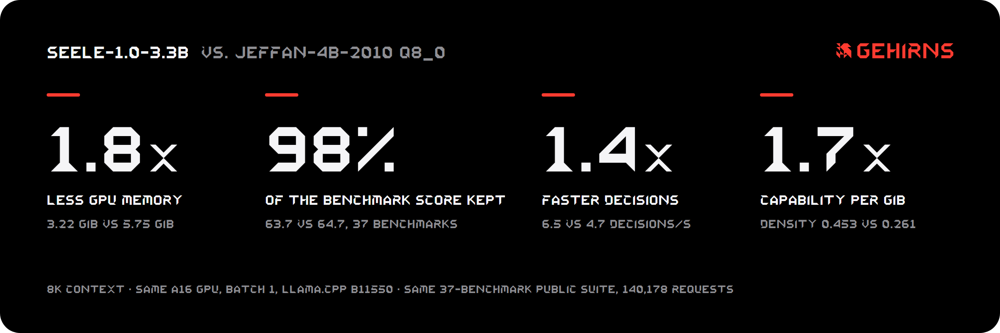
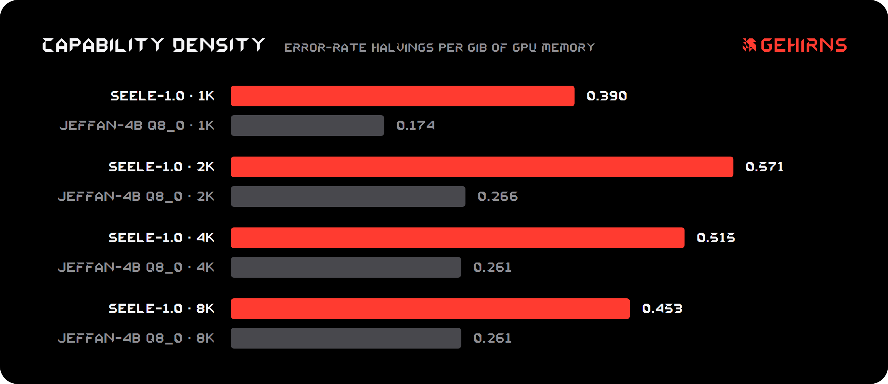
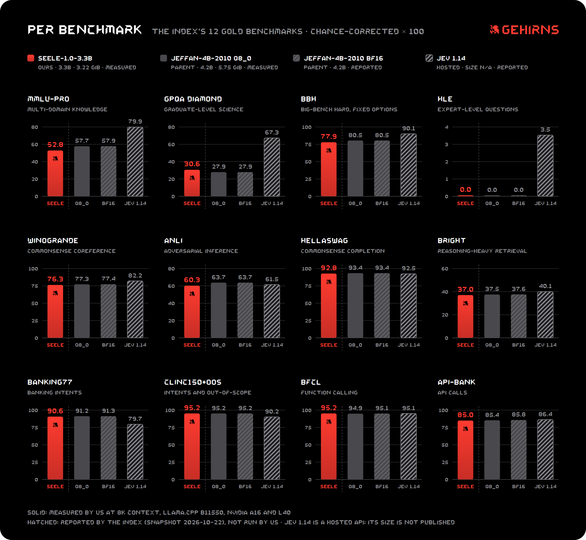
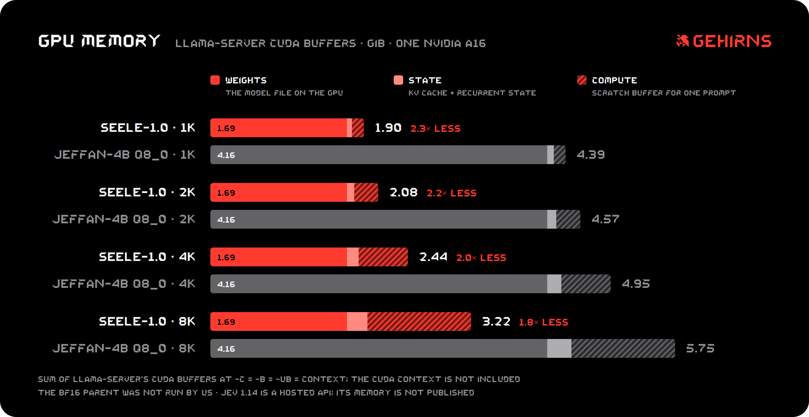

<p align="center"></p>

# seele-1.0-3.3B

**A 4B decision model in 1.7 GiB, with no training: a quarter of its layers removed, the rest at 4.4 bits per weight.**

seele-1.0-3.3B is a pruned and quantized version of [tattrongvu/Jeffan-4B-2010](https://huggingface.co/tattrongvu/Jeffan-4B-2010), made by GEHIRNS. Jeffan is a decision model built on [Qwen/Qwen3.5-4B](https://huggingface.co/Qwen/Qwen3.5-4B).
- **What it does:** it reads a state and a multiple-choice question and returns a probability for every option from one forward pass. It generates no text.
- **What changed:** 8 of the parent's 32 layers were removed, taking it from 4.21B to 3.31B parameters, and the rest are stored in standard GGUF formats.
- **What didn't:** no weight was trained.
- **Where it runs:** stock llama.cpp.

**Model:** [huggingface.co/GEHIRNS/seele-1.0-3.3B](https://huggingface.co/GEHIRNS/seele-1.0-3.3B) · **Website:** [gehirns.pages.dev](https://gehirns.pages.dev/)

<p align="center"></p>

## Results

Both models ran on the same setup:
- **Benchmark:** the public suite of the [Jev Decision Index](https://huggingface.co/spaces/multimodalart/jev-decision-index), version 0.3: 37 benchmarks in five areas, 140,178 requests.
- **Scoring:** the suite's own scorer. Each benchmark's native metric is corrected for chance (0 = guessing, 100 = perfect).
- **Engine:** llama.cpp b11550 with bidirectional attention, one request at a time.
- **Context:** a request longer than the context counts as wrong; nothing is truncated.

| Context | seele-1.0-3.3B | GPU memory (GiB) | Capability per GiB | Jeffan-4B-2010 Q8_0 | GPU memory (GiB) | Capability per GiB |
|---|---|---|---|---|---|---|
| 1K | 40.14 | **1.897** | **0.390** | 41.12 | 4.391 | 0.174 |
| 2K | 55.99 | **2.075** | **0.571** | 57.02 | 4.573 | 0.266 |
| 4K | 58.19 | **2.442** | **0.515** | 59.20 | 4.948 | 0.261 |
| 8K | 63.66 | **3.223** | **0.453** | 64.70 | 5.745 | 0.261 |

- **Capability per GiB** = −log₂(1 − score/100) / GiB: how many times the error rate is halved per gibibyte of GPU memory.
- **GPU memory** is the sum of llama-server's CUDA buffers: weights, KV cache, recurrent state and compute. It does not include the CUDA context.
- **The parent's own card** reports 64.85 for BF16, with the authors' engine at a 65,536-token context.
- **Speed** at 8K on one NVIDIA A16 GPU, batch 1, 500 requests, each model run twice back to back with the same results:
  - **seele-1.0-3.3B:** 6.5 decisions/s, latency p50 154 ms.
  - **Parent:** 4.7 decisions/s, latency p50 212 ms.
- **Jev 1.14**, TypeSafe's hosted decision model, scores 60.70 on the public index as the index reports it. It was not run by us, and its size and memory are not published.
  - seele-1.0-3.3B scores about 3 points above it there. That does not make it the better model overall.
  - **Private tests:** the index's Full score adds tests that only the index can run. There Jev 1.14 scores 60.24 and the parent 52.21, as the index reports them; the parent is much weaker on the index's new domains (33.5 against 48.3).
  - **seele-1.0-3.3B:** we cannot run those tests. We expect it to share its parent's gap there, but that is not measured.
  - **Knowledge:** Jev 1.14 also leads on the knowledge benchmarks (57.1 against 46.93).

<p align="center"></p>

**The honest trade-off:** the parent at Q8_0 scores 1.04 points higher at 8K, and 2.47 points higher on knowledge, but it needs 2.52 GiB more GPU memory and is 1.4× slower.
- **Accuracy matters most:** use the parent.
- **Memory or latency is the limit:** use seele-1.0-3.3B.

<p align="center"></p>

- **Per benchmark:** on 8 of the index's 12 gold benchmarks seele-1.0-3.3B is within 1 point of its parent at Q8_0. It loses most on MMLU-Pro (−4.9), ANLI (−3.5) and BBH (−2.6). Jev 1.14 leads on the knowledge benchmarks.
- **All 37 benchmarks:** 22 are within 1 point of the parent. The largest drops are outside the gold set: GSM8K (−15.9), math word problems, and CRUXEval (−7.2), predicting a program's output. Every score is in [`data/per-benchmark-8k.csv`](data/per-benchmark-8k.csv).

<p align="center"></p>

- **Memory:** the weights shrink from 4.16 to 1.69 GiB. The KV cache, recurrent state and compute buffer grow with the context and are about the same for both models, so the saving shrinks from 2.3× at 1K to 1.8× at 8K.

## How it works

1. **Measure.** Each of layers 12–30 was removed alone, and the change in the model's answer distribution was measured as KL divergence from BF16 over 370 calibration requests.
2. **Prune.** The six least damaging layers were removed together, then two more by greedy forward selection. That is 8 of 32 layers: seven Gated DeltaNet layers and one full-attention layer.
3. **Quantize.** We used llama.cpp's Q4_K_M mix with the FFN matrices at IQ4_XS and an importance matrix from SNLI, MultiNLI and MMLU validation prompts. The average is 4.38 bits per weight.

## Run it

```bash
llama-server -m seele-1.0-3.3B.gguf -c 8192 -b 8192 -ub 8192 --parallel 1 --ctx-checkpoints 0 -ngl 99 --port 8080
python decide.py
```

- **Bidirectional attention:** the GGUF sets it (`qwen35.attention.causal = false`). Keep `-b`/`-ub` at least as long as the longest prompt, and keep `--ctx-checkpoints 0`; otherwise llama.cpp splits the prompt and the answers change.
- **[`decide.py`](decide.py)** builds the parent's prompt token for token and returns one probability per option, exactly as our evaluation read them (checked on 100 questions: largest difference 0).

## Reproduce

- **Build the model:** [`recipe/BUILD.md`](recipe/BUILD.md) rebuilds seele-1.0-3.3B from the parent's Hugging Face weights. The steps are one `llama-quantize` call (prune and quantize), one metadata repair, then the release metadata. The importance matrix is in [`recipe/`](recipe/).
- **Check a build:** `python recipe/verify_tensors.py seele-1.0-3.3B.gguf recipe/seele-1.0-3.3B.tensor-types.tsv` compares every tensor's type and data hash with the release.
  - **On a second machine:** the rebuild matched the release in all metadata and in 310 of 317 tensors.
  - **The other 7:** `ssm_a` values from the BF16 conversion, 1 ulp apart; see BUILD.md.
- **Check the numbers:** [`data/`](data/) holds the scores, memory and speed behind every table and figure.

## Limitations

- **Decision model only:** it answers multiple-choice questions in the parent's prompt format and is not a chat model.
- **Scope:** one runtime (llama.cpp b11550) and the public suite of one index. Each model ran the full suite once.
- **Accuracy:** below the parent, most of all on knowledge: GSM8K −15.9, CRUXEval −7.2 and MMLU-Pro −4.9 at 8K. On the 500 ANLI and MMLU-Pro speed-test requests the gap was 3.3 points.
- **Long requests:** 31 of the 140,178 requests are longer than 8K tokens and were not run.
- **The name is ours.** seele-1.0-3.3B is not affiliated with the parent's authors, the index or TypeSafe.

## License

Apache-2.0, the same as Jeffan-4B-2010 and Qwen3.5-4B. [`NOTICE`](NOTICE) states what was changed. See [LICENSE](LICENSE).
